<div align="center">

<a href="https://swarmsar.vercel.app">
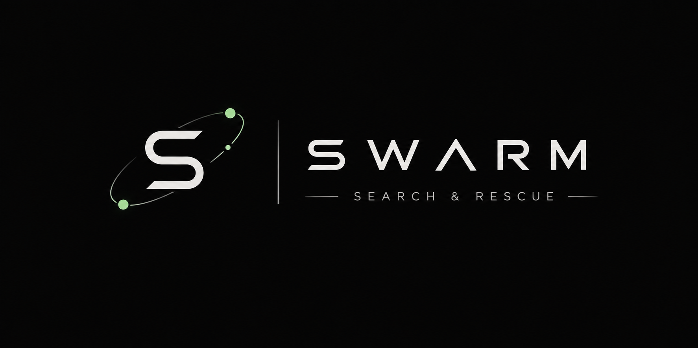
</a>

# SWARM · Search & Rescue

### Send the robots first. Share what they learn. Help people find the way.

**A heterogeneous multi-agent search-and-rescue research and teaching platform.**

Autonomous rovers and drones explore simulated disaster sites, build private maps, exchange discoveries and locate survivors. A 3D mission workspace, recurrent PPO policies, an experimental GNN, a rescue dossier, and a separate ROS 2 / Gazebo stack make the complete workflow visible—from a robot's local observation to an operator's mission report.

[**READ THE SWARM SAR FIELD GUIDE ↗**](https://swarmsar.vercel.app) · [**RUN THE MISSION LOCALLY ↓**](#run-it-yourself)

[](frontend/package.json)
[](frontend/src/scene/)
[](frontend/package.json)
[](pyproject.toml)
[](experiments/gnn/README.md)
[](simulation/ros2_ws/)

</div>

---

[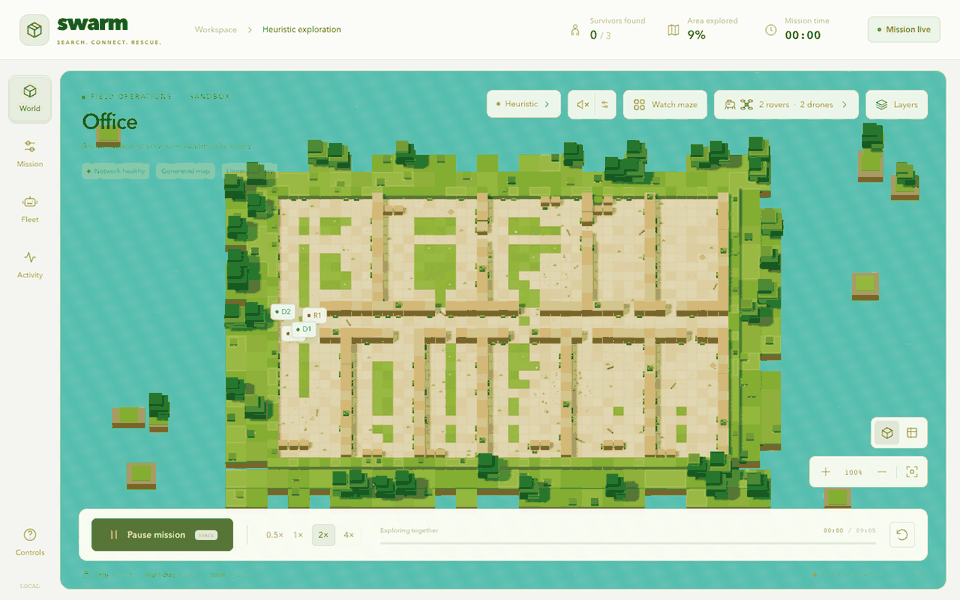](https://swarmsar.vercel.app)

<p align="center"><em>Real browser recording: an office map, two rovers and two drones, heuristic control at 4× playback. This historical recording predates the official branding and dossier; current interface captures appear below.</em></p>

> **Start here:** read or listen to the [SWARM SAR field guide](https://swarmsar.vercel.app), then run the browser mission locally to explore **Explain**, **Observatory**, fleet coordination and rescue reports. ROS/Gazebo runs separately on Linux.

## Explore this project

| See the product | Understand the engineering | Run and verify |
| :--- | :--- | :--- |
| [Access every experience](#access-every-experience) | [Why this problem matters](#why-we-built-it) | [Windows setup](#windows--command-prompt) |
| [All features](#feature-atlas) | [System architecture](#how-the-system-connects) | [macOS / Linux setup](#macos--linux) |
| [3D mission control](#3d-mission-control) | [Rovers, drones and sensors](#the-robots-rovers-and-drones) | [Public hosting](#share-your-windows-host-with-the-web) |
| [Survivor stories](#a-discovery-is-a-person-not-just-a-counter) | [Communication and private maps](#private-maps-and-peer-communication) | [ROS / Gazebo launch](#run-the-ros-2-stack) |
| [Rescue dossier](#rescue-dossier-from-discovery-to-a-readable-plan) | [PPO and GNN](#learning-from-frontier-baselines-to-ppo-and-gnn) | [Tests and evidence](#validation-and-evidence) |
| [2D policy animation](#2d-python-interface-actual-learned-policy-inference) | [ROS 2, Gazebo and SLAM](#ros-2-gazebo-rviz-and-slam) | [Repository guide](#inside-the-repository) |
| [Fieldbook and Explain](#built-to-explain-as-well-as-demonstrate) | [Results and limits](#results-with-their-context) | [Documentation](#keep-exploring) |

## Why we built it

After an earthquake, structural collapse or mine accident, a rescuer may face unstable debris, unknown routes, blocked visibility and unreliable GPS. A robot team needs to explore with incomplete information, coordinate despite weak communication, and identify useful evidence without assuming every agent knows the whole map.

SWARM turns those constraints into an inspectable simulation:

- **Different robots, complementary roles:** rovers explore ground routes; drones provide a different sensing and mobility profile.
- **Private knowledge:** each robot acts from local observations and information actually received from teammates.
- **Imperfect communication:** range, obstacles, delays, loss and isolation affect cooperation.
- **Learned coordination:** recurrent PPO selects high-level goals; graph attention is implemented and evaluated as an experimental extension.
- **An operator's view:** people can inspect the mission, acknowledge each survivor story, and generate a map-based rescue dossier.

This repository is a **synthetic research and teaching prototype**. Its simulated sensors, abstract batteries and computed rescue routes do not establish readiness for real disaster deployment. [Problem statement](docs/problem_statement.md) · [Detailed approach](detailed_approach.md).

## Access every experience

| Experience | Online / recorded access | Run it yourself |
| :--- | :--- | :--- |
| **3D browser mission** | [Animated recording](docs/media/frontend/mission-live.gif) · [SWARM SAR field guide](https://swarmsar.vercel.app) | `npm run swarm` → http://localhost:5173/ |
| **Interactive Explain guide** | Choose **Explain** in the app header | Same frontend; no Python required for the story |
| **Private-map and peer observatory** | [Read the observatory guide](https://swarmsar.vercel.app) | http://localhost:5173/?mode=observatory |
| **GNN concept walkthrough** | Observatory → **GNN concept** | Frontend teaching view; example attention, not live GNN inference |
| **Rescue dossier** | Latest integrated checkout → **Dossier** or **P** | Review maps, survivors and routes; export HTML/JSON or Print/PDF |
| **Saved PPO in the browser** | Mission → PPO → preview → create → launch; requires available host capacity | Local Python service on port 8765, proxied by the frontend |
| **2D learned-policy viewer** | [Recorded Python PPO GIF](docs/media/ppo_754k_seed10000.gif) | `simulation/scripts/demo_ppo.py --live` |
| **ROS 2 / Gazebo physics** | [Original Gazebo captures](docs/media/simulation-screenshots/) | Separate sourced Linux ROS/Gazebo workspace |
| **RViz mapping** | [Recorded map sequence](docs/media/rviz-map-sequence.gif) | Physics / SLAM launch with RViz |
| **ROS telemetry in the browser** | The ROS page can be opened offline to inspect the interface | http://localhost:5173/?mode=ros plus a reachable ROS bridge |
| **Narrated fieldbook** | [Read and listen](https://swarmsar.vercel.app) | `npm run swarm` → http://localhost:8088/ |

**A GIF is a recorded demonstration, not a live stream.** Interactive operation happens in the app. The online app does not automatically provide a Linux ROS host or a GPU training session.

## Feature atlas

| Area | Implemented capabilities | Evidence / implementation |
| :--- | :--- | :--- |
| **3D world** | Procedural browser scenes, rovers and drones, animated movement, terrain, survivor markers and exploration presentation | [Current workspace](docs/media/readme-2026-11-01/mission-light.png) · [Scene code](frontend/src/scene/) |
| **Camera and viewing** | Orbit, pan, cursor-anchored zoom, top-down/isometric views, focus/follow, fit/reset and interface-free viewing | [3D UI](docs/media/readme-2026-11-01/mission-light.png) · [Camera tests](frontend/src/tests/camera.test.ts) |
| **Mission authoring** | Presets, seeded generation, custom maze dimensions, layout drawing, path/wall/debris brushes, undo/redo and protected start/survivor cells | [Map editor](docs/media/final-showcase/map-editor.png) · [Editor](frontend/src/components/MazeEditor.tsx) |
| **Survivor placement** | Automatic/custom counts, random placement, manual placement, removal and reset-before-edit constraints | [Mission controls](frontend/src/components/LeftPanel.tsx) · [Placement tests](frontend/src/tests/survivorPlacement.test.ts) |
| **Fleet setup** | Configurable rover/drone mix, up to ten robots in the browser, per-agent state, energy, evidence and movement inspection | [Fleet photo](docs/media/frontend/office-fleet.png) · [Fleet panel](frontend/src/components/RightPanel.tsx) |
| **Control modes** | Autonomous heuristic exploration, manual waypoints/driving, mixed control and separate authoritative Python PPO missions | [Controller integration](docs/guides/ppo_frontend_integration.md) |
| **Energy and duration** | Limited/unlimited energy, automatic/custom/unlimited mission duration and scenario-aware settings | [Settings implementation](frontend/src/components/) · [Mission tests](frontend/src/tests/missionControls.test.ts) |
| **Human encounters** | Pause on discovery, deterministic fictional survivor dialogue, sequential acknowledgement and explicit continuation | [Story capture](docs/media/final-showcase/survivor-story.png) · [Encounter tests](frontend/src/tests/survivorEncounter.test.ts) |
| **Rescue dossier** | Merged-belief map, confirmed/suspected records, configurable entry, computed ingress routes, route cards, directions, sequencing and exports | [Dossier guide](docs/guides/rescue_dossier.md) · [Report photo](docs/media/rescue-dossier/desktop-light.png) |
| **3D rescue routes** | Optional route layer over the world, computed from the dossier's map-based planning | [Route-layer capture](docs/media/final-showcase/routes-3d.png) · [Overlay code](frontend/src/scene/SafeRouteOverlay.tsx) |
| **Private maps** | Per-agent occupancy, locally discovered terrain, evidence and localization uncertainty | [Private-map photo](docs/media/readme-2026-11-01/observatory-map.png) · [Simulation](simulation/src/swarm_sar/) |
| **Peer networking** | Recipient-specific messages, radio reachability, delay/loss, bandwidth, TTL, partitions, topology and packet events | [Peer graph](docs/media/readme-2026-11-01/observatory-network.png) · [Observatory guide](docs/guides/swarm_observatory.md) |
| **Mission observatory** | Spatial/peer views, agent selection, private map, paths/frontiers, message filters, export, camera controls and view freeze | [Observatory](frontend/src/observatory/) |
| **PPO workflow** | Python-generated setup preview, mission creation, saved actors, individual recurrent state, validated snapshots and checkpoint provenance | [Preview photo](docs/media/updates/ppo-preview.png) · [Completed mission](docs/media/frontend/ppo-completed.png) |
| **Experimental GNN** | Receiver-local attention residual, warm-start, graph-gradient checks, bounded pilot runs, checkpoint integrity and paired ablation evaluation | [Experiment](experiments/gnn/) · [Validation audit](docs/audits/gnn_implementation_validation.md) |
| **GNN teaching view** | Receiver selection, illustrative messages, softmax score adjustment and four explanation stages | [GNN photo](docs/media/readme-2026-11-01/gnn-concept.png) · [Concept guide](docs/guides/gnn_concept_demo.md) |
| **Explain mode** | Ten chapters, fourteen scenes, interactive learning examples, optional read-aloud, original evidence gallery and mission restoration | [Guide photo](docs/media/readme-2026-11-01/explain-dark.png) · [Explain guide](docs/guides/explain_mode.md) |
| **Guided tours** | Twelve browser-observatory scenes and fifteen ROS-observatory scenes; source-aware highlights and viewing-state restoration | [Tour definitions](frontend/src/explain/observatoryTourSteps.ts) |
| **Audio** | Ambient soundscape, spatial mission sounds, mute/volume controls and browser narration | [Audio code](frontend/src/audio/) · [Audio tests](frontend/src/tests/audio.test.ts) |
| **Design and accessibility** | Official branding, saved light/dark mode, responsive layouts, keyboard controls, focus handling and reduced-motion accommodations | [Light](docs/media/readme-2026-11-01/mission-light.png) · [Dark](docs/media/readme-2026-11-01/mission-dark.png) · [Mobile](docs/media/readme-2026-11-01/explain-mobile.png) |
| **ROS 2 / Gazebo** | Custom robot descriptions, wheel/rotor physics, sensor bridges, waypoint flight/drive controllers and readiness-gated RViz | [Physics evidence](docs/evidence/physics-demo/) · [ROS workspace](simulation/ros2_ws/) |
| **Rover SLAM integration** | Per-rover mapping, estimated feedback, frame ownership, private maps and peer map/frontier exchange; runtime validation boundaries documented | [Integration guide](docs/guides/slam_integration.md) |
| **Training and evaluation** | Expert export, behavior cloning, PPO, source/observation contracts, fixed cohorts, quality gates and sealed final seeds | [Training workspace](training/) · [Benchmarks](docs/benchmarks/README.md) |
| **Hosting and documentation** | One-command local launcher, built-asset public gateway, API limits, Windows tunnel guide and separately hosted audio fieldbook | [Hosting guide](docs/guides/windows_public_hosting.md) · [Fieldbook](https://swarmsar.vercel.app) |

## 3D mission control

| Current light workspace | Current dark workspace |
| :---: | :---: |
| [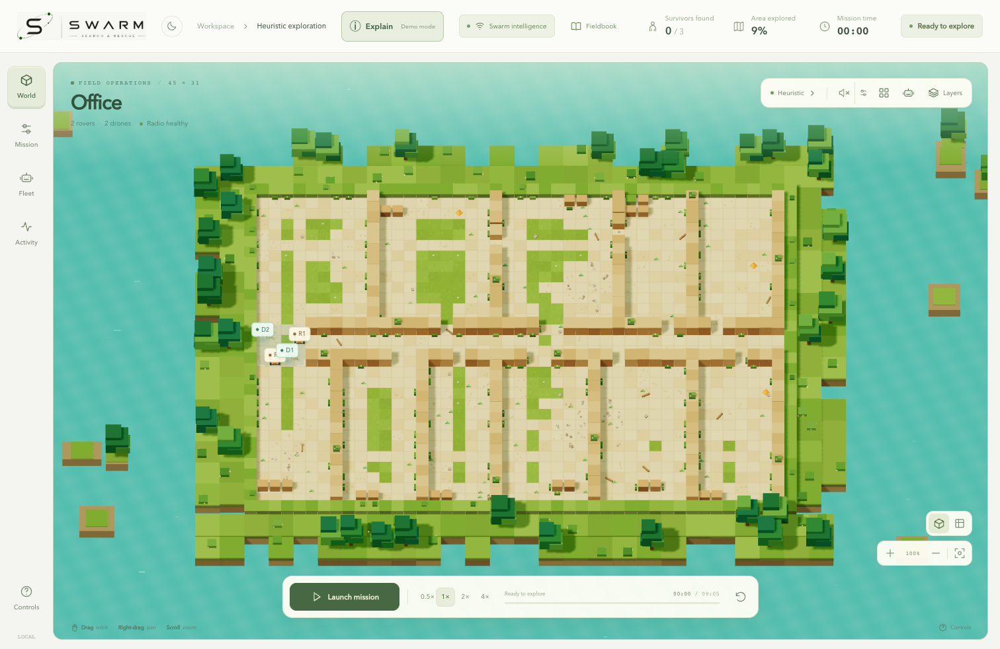](docs/media/readme-2026-11-01/mission-light.png) | [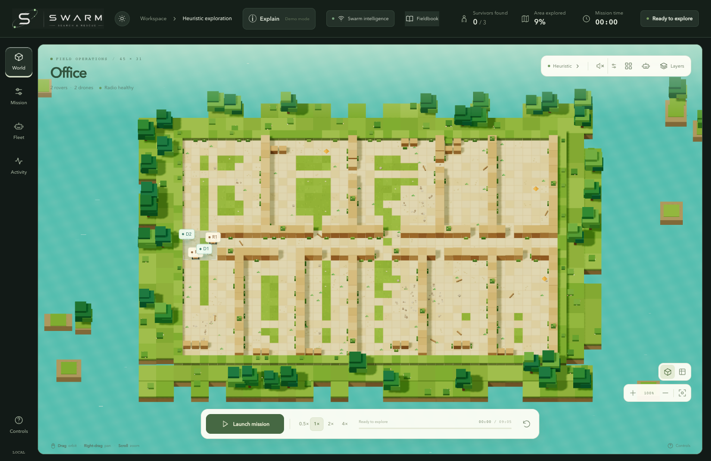](docs/media/readme-2026-11-01/mission-dark.png) |

The browser combines a voxel-style world with practical mission controls. Configure a site and team, select a controller, inspect progress and move between the world, Mission, Fleet and Activity views. Theme selection persists; scientific maps and original evidence retain their authored colors.

### Different sites, different teams

| Office · fleet inspection | Mine · rover and drone team | Apartment · another team configuration |
| :---: | :---: | :---: |
| [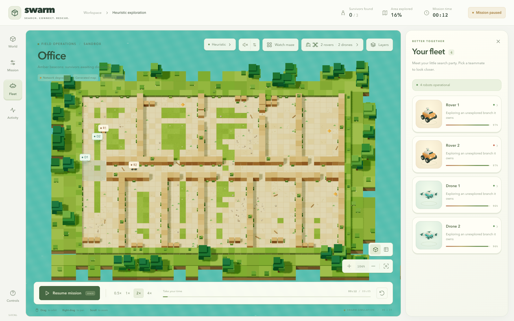](docs/media/frontend/office-fleet.png) | [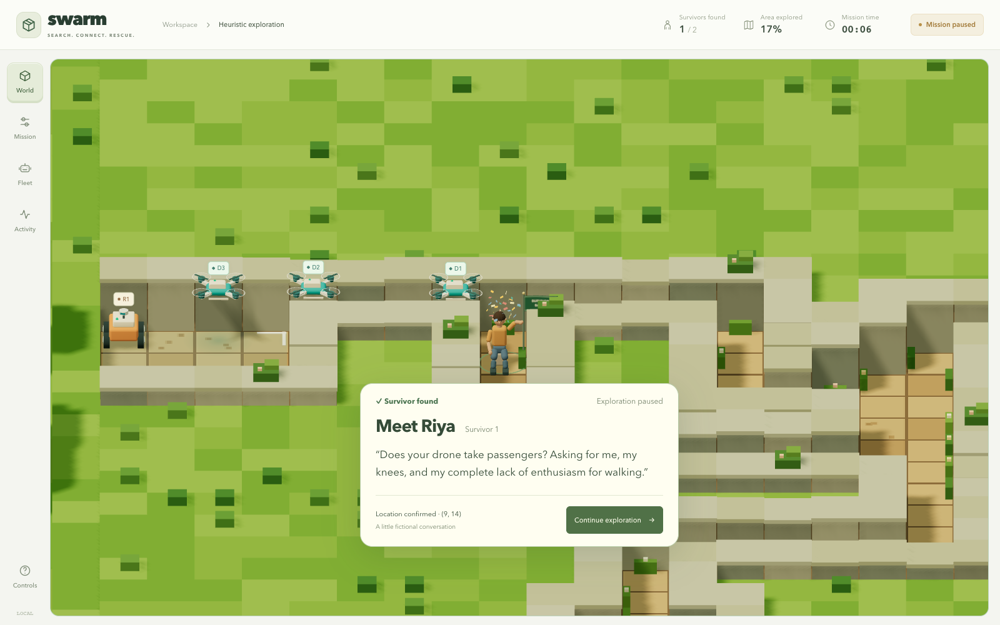](docs/media/frontend/mine-team.png) | [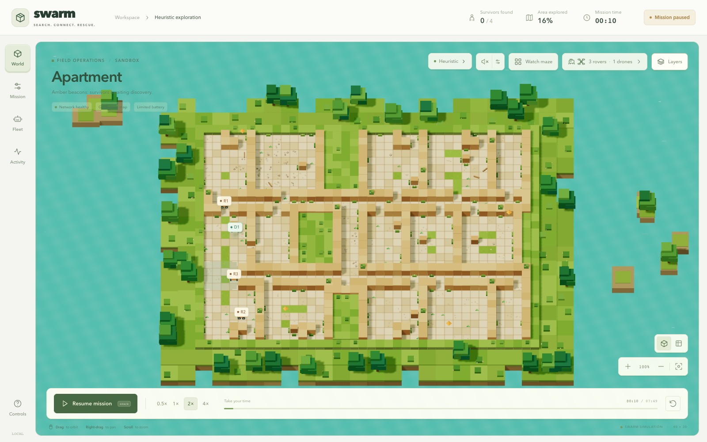](docs/media/frontend/apartment-team.png) |

Historical real captures: **office 2R+2D**, **mine 1R+3D**, and **apartment 3R+1D**. They demonstrate UI and scenario variation, not three additional benchmarks. [Capture metadata](docs/media/frontend/capture-manifest.json).

<details>
<summary><strong>Draw a site instead of accepting a preset</strong></summary>

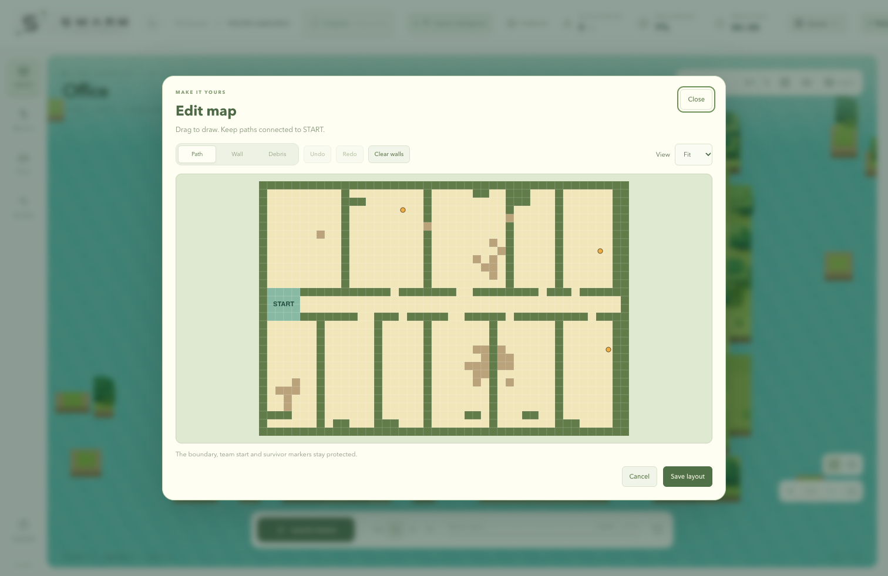

Choose the custom maze controls in Mission settings. Draw paths, walls and debris; undo/redo changes; zoom the editing canvas; save or cancel. Boundary, robot start and survivor cells remain protected, and edited layouts are checked before use. [Map editor implementation](frontend/src/components/MazeEditor.tsx).

</details>

## A discovery is a person, not just a counter

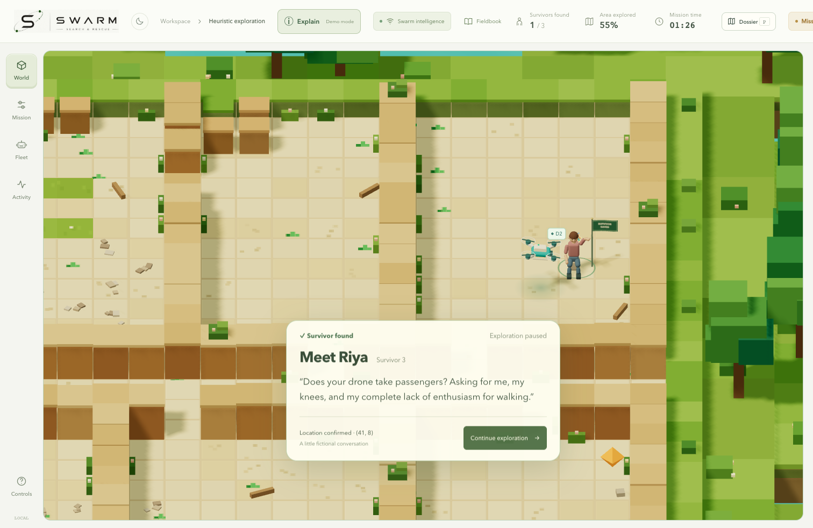

The existing discovery sequence is preserved in the dossier integration:

**Robot confirms a survivor → exploration pauses → survivor story appears → you press Continue → exploration can proceed.**

If several confirmations arrive together, stories are queued and acknowledged one at a time. Ordinary resume cannot bypass a pending story, and opening the dossier cannot dismiss it. After the final acknowledgement, **View mission report** opens the rescue dossier. The dialogue is explicitly fictional presentation content; the underlying discovery is a real event from that simulated mission.

[Story implementation](frontend/src/components/SurvivorEncounter.tsx) · [Encounter regression tests](frontend/src/tests/survivorEncounter.test.ts) · [Dossier integration tests](frontend/src/tests/dossierIntegration.test.ts).

## Rescue dossier: from discovery to a readable plan

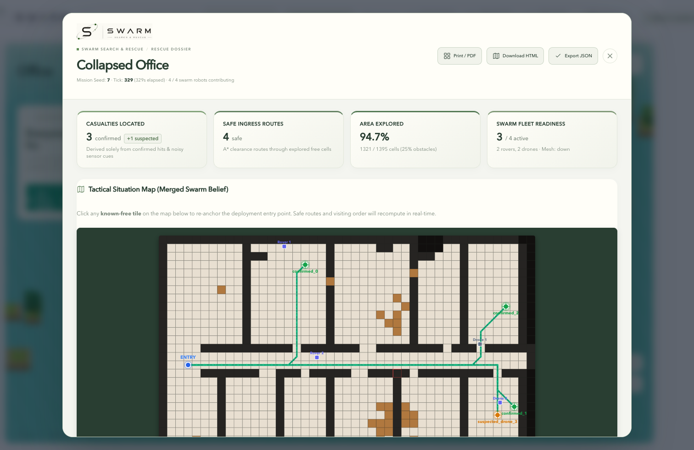

The `human_map` feature is integrated into the current app with official branding, paper/sage surfaces, restrained depth and matching light/dark themes. Open **Dossier** or press **P**. Opening a report pauses an active mission; closing it leaves the mission paused until you explicitly resume.

The dossier brings together:

- **Mission identity:** seed, elapsed mission time, contributing robots and team composition.
- **Situation map:** merged explored beliefs, terrain, entry point, survivor records and route overlays.
- **Confirmed versus suspected:** actual confirmations remain separate from noisy sensor cues.
- **Ingress planning:** A* route computation with clearance and hazard penalties, an adjustable known-free entry, and explicit unknown/unreachable cases.
- **Per-survivor detail:** location, confidence, detecting/confirming agent, route length, risk score, estimated travel time and turn-by-turn instructions.
- **Multiple destinations:** suggested visiting order and route sequencing.
- **Fleet and audit:** active/depleted agents, connectivity context, post-shield collision counts where tracked, and limitations.
- **Offline handoff:** standalone HTML, structured JSON and browser Print / Save as PDF.

| Selected survivor route card | Routes in the 3D world |
| :---: | :---: |
| [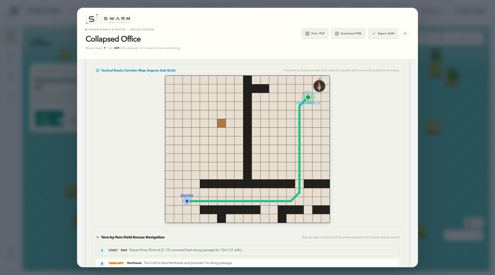](docs/media/final-showcase/route-card.png) | [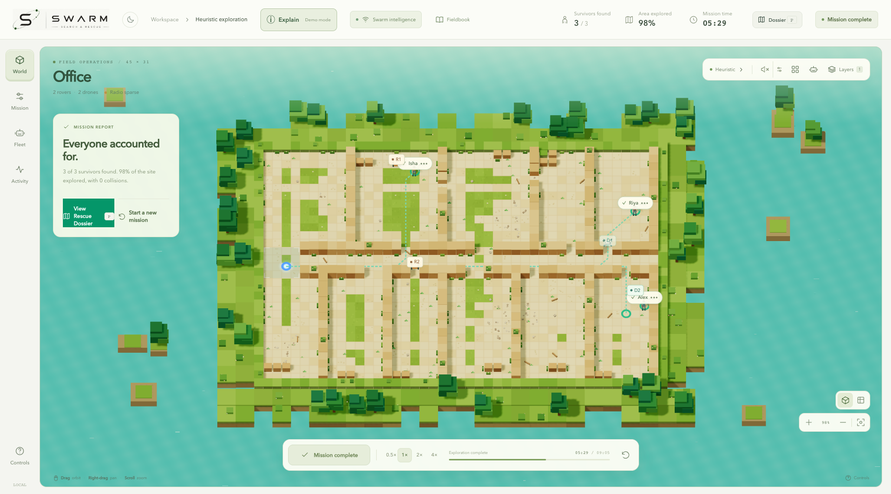](docs/media/final-showcase/routes-3d.png) |

<details>
<summary><strong>Dark and mobile dossier views</strong></summary>

| Dark desktop | Dark mobile |
| :---: | :---: |
| 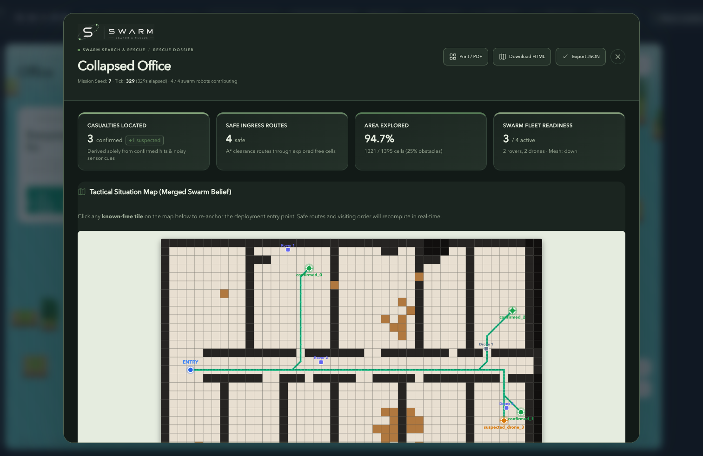 | 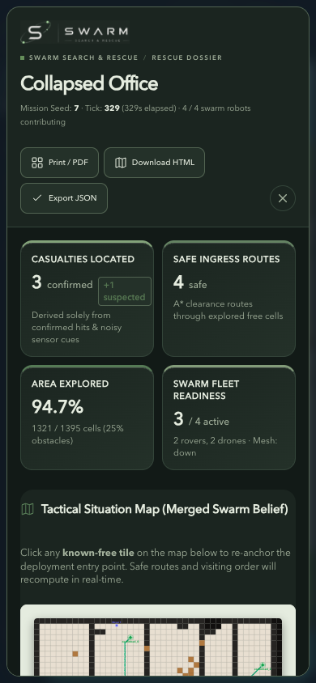 |

</details>

The merged dossier is an **operator view**, not information secretly supplied to each agent. “Safe route” means a computed route under the simulation's map and cost assumptions; it does not certify structural safety or real rescue feasibility. [Dossier guide and validation](docs/guides/rescue_dossier.md) · [Route planner](frontend/src/dossier/safeRoute.ts) · [Planning assumptions](frontend/src/dossier/config.ts).

## Private maps and peer communication

| A robot's explored occupancy | The team's peer topology |
| :---: | :---: |
| [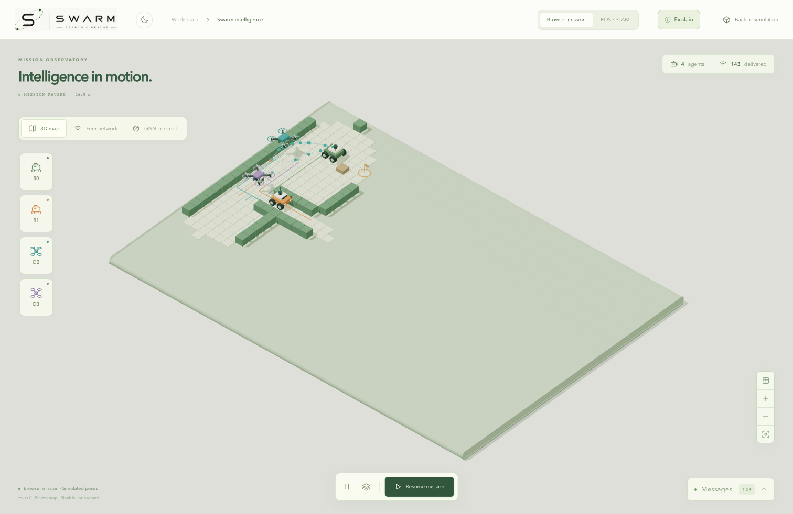](docs/media/readme-2026-11-01/observatory-map.png) | [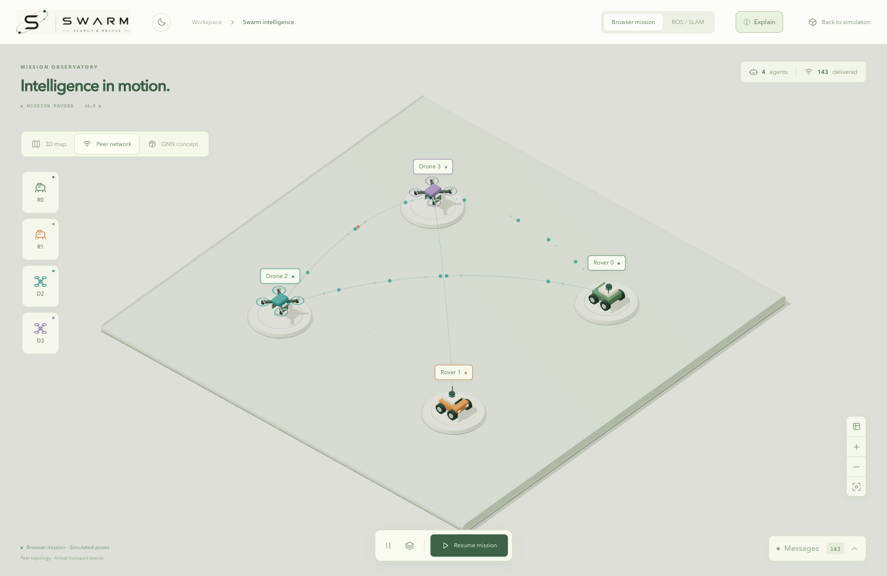](docs/media/readme-2026-11-01/observatory-network.png) |

Each agent starts with partial knowledge. Local sensing updates its belief, frontier search identifies useful unexplored boundaries, and received messages add bounded teammate information. The peer transport accounts for radio range, obstacles, loss, delay, bandwidth, message age/TTL and partitions. A connection line indicates topology; transport events and delivery metrics provide separate evidence of communication.

The observatory lets you select a robot, inspect its own map, view trajectories/frontiers, filter messages, export telemetry and freeze the visualization without claiming to freeze or control an external ROS world. Browser simulated poses and ROS telemetry are labeled by source.

**PPO does not carry radio messages.** PPO learns action selection; the communication layer transports messages. The GNN experiment aggregates received peer features inside a policy extension. These are different responsibilities. [Detailed approach](detailed_approach.md) · [Observatory guide](docs/guides/swarm_observatory.md).

## The robots: rovers and drones

The project uses **custom repository robot descriptions and browser geometry**, not NVIDIA robot assets. NVIDIA hardware was used for training; it is not the source of the robot models.

### Browser and Python grid agents

| Property | Rover | Drone proxy |
| :--- | :--- | :--- |
| Role | Ground exploration and local confirmation | Wider sensing profile and complementary exploration |
| Occupancy sensing radius | 4 cells | 7 cells |
| Synthetic thermal / acoustic radius | 6 / 10 cells | 8 / 12 cells |
| Confirmation radius | 2 cells | 2 cells |
| Base abstract energy | 300 units | 240 units |
| Ordinary move cost | 1 unit | 1 unit |
| Rubble move cost | 2 units | 1 unit |
| Idle cost | 0.1 unit per step | 0.1 unit per step |
| Wall crossing | Disabled | Disabled |
| Base radio radius | 8 cells | 10 cells |
| Localization | Synthetic odometry drift and uncertainty | Synthetic odometry drift and uncertainty |

These are base values from [robot configuration](configs/robots.yaml). Grid drones are **planar proxies**, not full aerial dynamics. Browser settings can scale budgets and permit unlimited energy; these units are not battery watt-hours or a physical runtime estimate. There is no charging/automatic return-to-base battery model implied by these values.

### Physical Gazebo models

| Model | Motion implementation | Sensor implementation |
| :--- | :--- | :--- |
| [Custom rover](simulation/ros2_ws/src/swarm_sar_description/urdf/rover.urdf.xacro) | Four-wheel skid-steer geometry, Gazebo differential-drive system and wheel feedback | Planar LiDAR, IMU and odometry |
| [Custom quadrotor](simulation/ros2_ws/src/swarm_sar_description/urdf/drone.urdf.xacro) | Multicopter motor model and velocity control; takeoff, hover and waypoint flight | Planar LiDAR, IMU, downward range and downward RGB camera |

The two physical robot types do **not** have identical sensor suites. Synthetic thermal/acoustic survivor evidence is a separate sensing/oracle mechanism; it is not a claim that the URDF includes calibrated thermal/acoustic hardware. The Gazebo models do not inherit the grid's battery-discharge behavior.

## 2D Python interface: actual learned-policy inference

[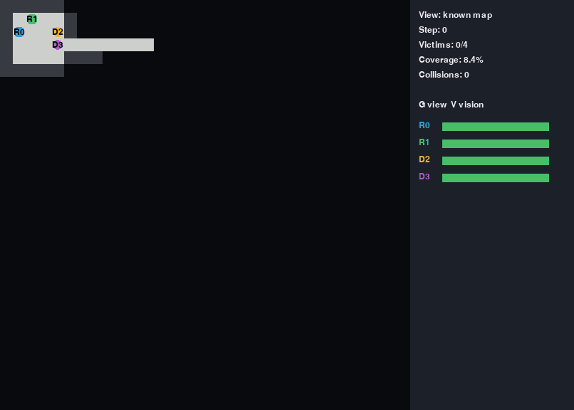](docs/guides/ppo_demo.md)

This is the Python grid renderer running the selected recurrent PPO policies: **two rovers + two drones**, development seed **10000**, **4/4 survivors in 94 steps**, and **90.48% coverage**. It is actual saved-policy inference, not training or a prerecorded action script.

The viewer and browser PPO mode are different presentations of the learned grid environment. They are not independent benchmark results. The renderer can expose operator ground truth for inspection; robot decisions still use their policy observations. [Inference evidence](docs/validation/ppo_demo_validation.json).

### Open the 2D viewer on Windows

After installing the project, prepare the bundled checkpoint once:

```cmd
.venv\Scripts\python.exe -c "from backend.ppo_service import prepare_checkpoint, DEFAULT_CHECKPOINT; prepare_checkpoint(DEFAULT_CHECKPOINT)"
.venv\Scripts\python.exe simulation/scripts/demo_ppo.py --live --seed 10000 --output training/runs/ppo_demo_live_01
```

Without `--live`, export a GIF instead:

```cmd
.venv\Scripts\python.exe simulation/scripts/demo_ppo.py --seed 10000 --output training/runs/ppo_demo_recorded_01
```

Each output directory must be fresh. Outputs include `mission.gif`, metrics, events, trajectories and a provenance manifest. In the live viewer: **V** toggles ranges, **G** toggles operator truth, and **Q/Escape** exits. On macOS/Linux use `.venv/bin/python` in place of the Windows executable. [Full viewer guide](docs/guides/ppo_demo.md).

### The same selected checkpoint in the browser

| Python-generated setup preview | Completed Python-backed browser mission |
| :---: | :---: |
| [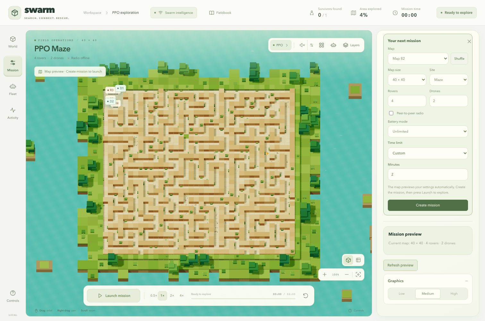](docs/media/updates/ppo-preview.png) | [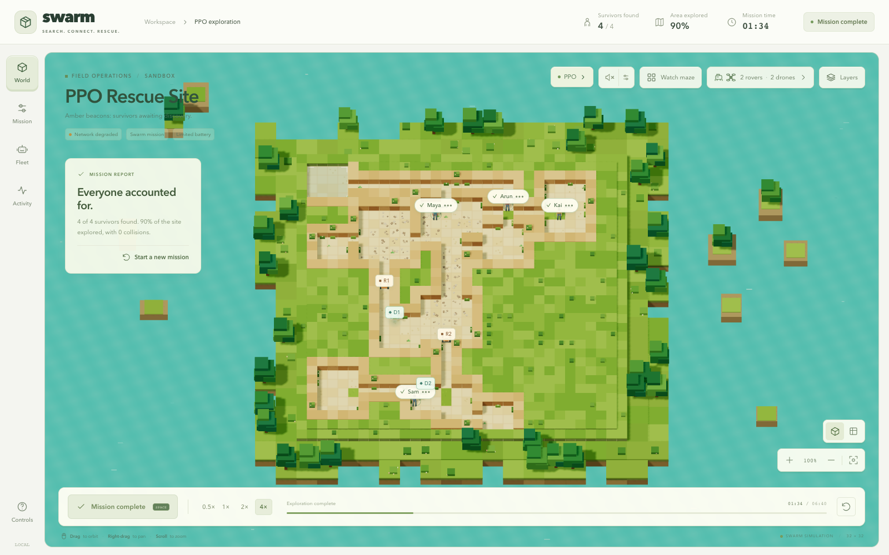](docs/media/frontend/ppo-completed.png) |

Choose Mission → PPO, configure the supported map/fleet settings, inspect the preview, **Create mission**, then **Launch**. The backend owns the environment and recurrent state. The frontend validates snapshots and renders them; it does not substitute heuristic actions for a failed PPO request. [Browser PPO integration](docs/guides/ppo_frontend_integration.md).

## Learning: from frontier baselines to PPO and GNN

### Recurrent PPO

The learning pipeline builds on the deterministic simulator and a working decentralized frontier baseline:

1. Generate and validate expert demonstrations.
2. Train behavior cloning against the versioned observation/action contract.
3. Continue with bounded PPO updates and checkpoint integrity checks.
4. Evaluate fixed development cohorts and stress conditions.
5. Compare candidates and preserve the selected checkpoint's provenance.

The served model uses **two type-shared policies**, `rover_policy` and `drone_policy`, with **individual recurrent state per agent**. The `gpu-v1` interface contains **229 observation values**, a **seven-action mask**, and **256-unit LSTM memory**. Actions represent five frontier choices, investigation and hold; the environment handles movement and collision shielding.

The bundled checkpoint was selected at **753,664 training steps**. Loading verifies its tree digest and restored actor hashes before CPU inference. Training and inference are separate operations: serving this checkpoint does not start Ray rollout workers or require a GPU.

[Training overview](training/README.md) · [Selected checkpoint](models/ppo_754k/) · [Observation contract](training/scripts/verify_policy_contract.py) · [Benchmark protocol](docs/benchmarks/README.md).

### Experimental graph attention

The implemented GNN extension constructs a **receiver-local one-hop graph** from local features and up to eight received peer slots. Masked query/key attention and value aggregation produce a residual into the existing recurrent policy input. Warm-start checks preserve the original policy at zero residual; pilot runs verify that both the graph encoder and residual actually update.

The experiment includes CUDA preflight, bounded training, resumable verified checkpoints, source/artifact hashes, paired evaluation and a graph-disabled ablation. **It has not been promoted into the served policy, and an improvement has not been established.** An active graph branch alone is not evidence that coordination improved. [Implementation/runbook](experiments/gnn/README.md) · [Validation audit](docs/audits/gnn_implementation_validation.md) · [Overnight implementation plan](docs/planning/gnn_overnight_plan.md).

### An interactive way to teach the graph

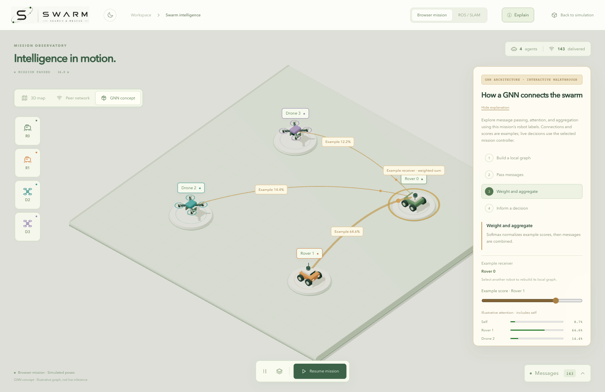

The frontend's **GNN concept** view explains four stages: build a local graph, pass messages, weight/aggregate, and inform a decision. Adjust an example score or choose a different receiver to see the illustration change. The displayed weights are **authored examples, not live learned attention**, and this view does not change robot actions. [Concept demonstration](docs/guides/gnn_concept_demo.md).

## ROS 2, Gazebo, RViz and SLAM

The robotics workspace is a separate execution path with real Gazebo dynamics and ROS topics. It complements the browser/grid prototype; a browser mission is not a Gazebo process, and opening the ROS page does not install or launch the robotics stack.

### Actual Gazebo disaster-world captures

| Overview | Overhead |
| :---: | :---: |
| [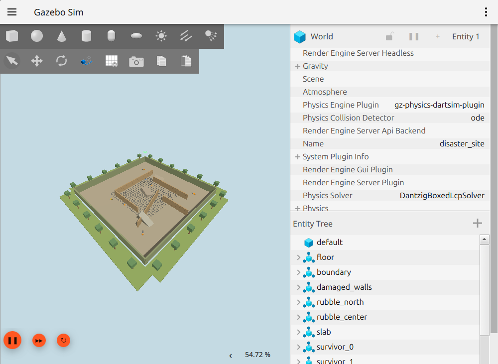](docs/media/simulation-screenshots/03-gazebo-overview.png) | [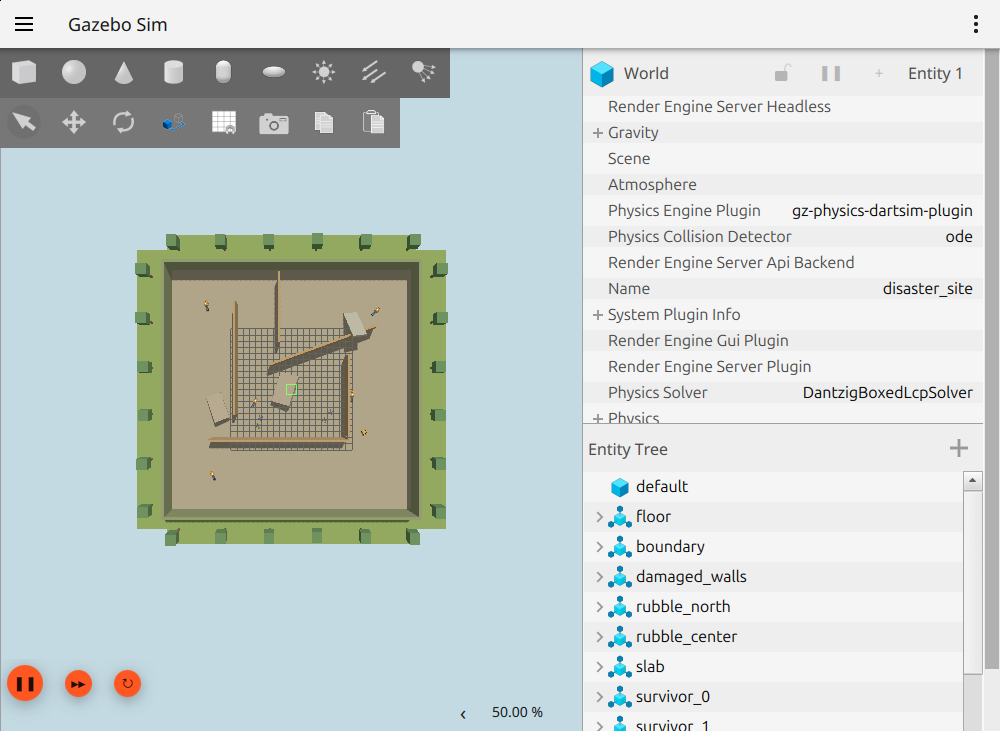](docs/media/simulation-screenshots/07-gazebo-top.png) |

<details>
<summary><strong>More original camera views of the same world</strong></summary>

| Initial scene | West camera | East camera |
| :---: | :---: | :---: |
| 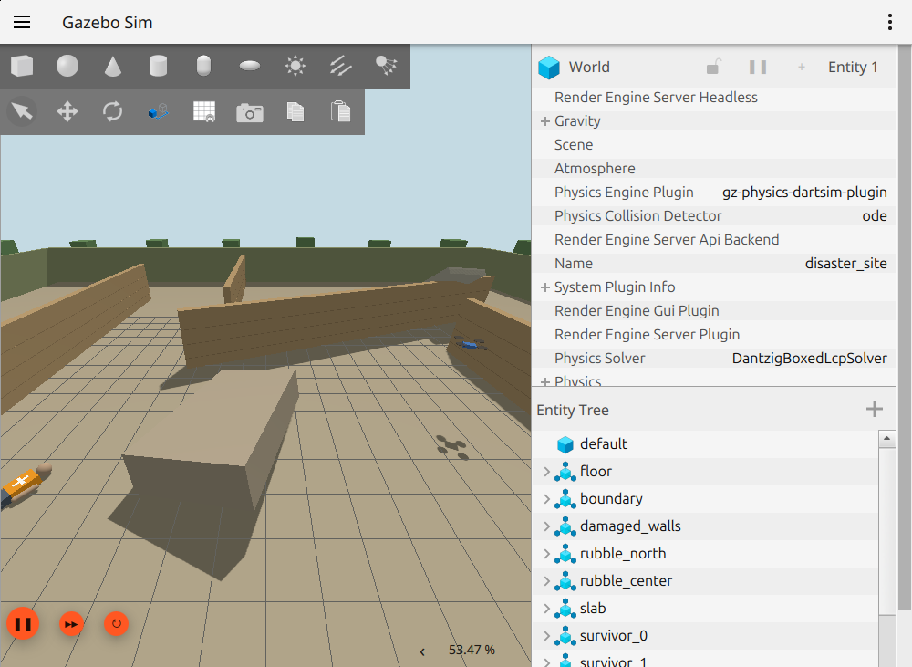 | 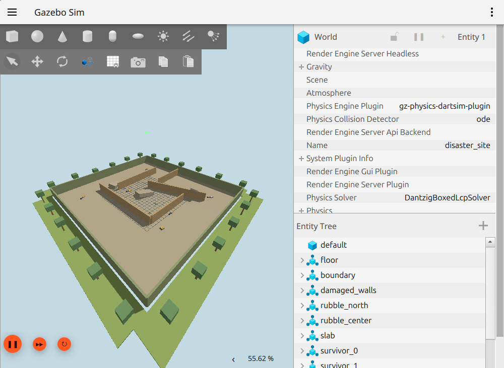 | 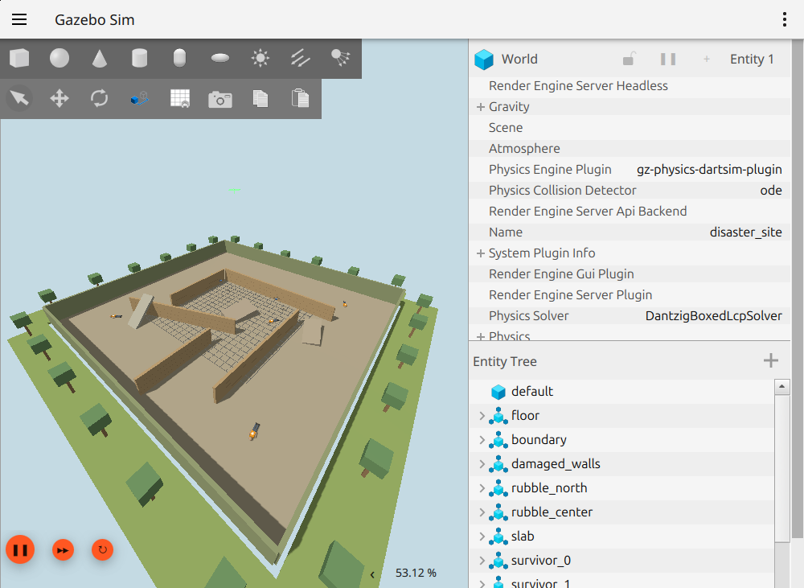 |

These are different views of **one world and one team**, not separate validated environments.

</details>

The recorded presentation profile contains **one rover and two drones**. The rover drives a waypoint circuit; the drones take off, hover and fly separate waypoint circuits at target altitudes **3.5 m and 4.5 m**. Custom world geometry, survivor figures, sensors, controllers, bridging and readiness checks are checked in.

Historical Linux validation includes completed rover circuits, drone stage progression, pose/tilt samples, stream counts and controller logs. The final 130-second wall-time probe received every requested stream; it is an engineering diagnostic, not an all-survivor rescue benchmark. [Recorded motion evidence](docs/evidence/physics-demo/README.md) · [Controller log](docs/evidence/physics-demo/rover-controller.log) · [Final probe](docs/evidence/physics-demo/final-motion.json).

### Watch the recorded RViz map sequence

[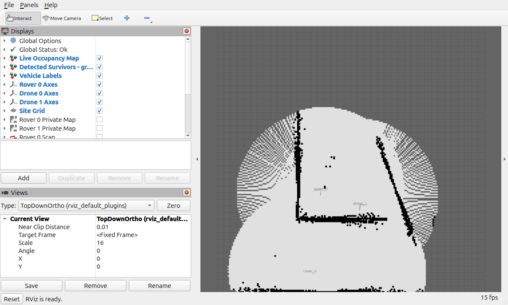](docs/media/rviz-map-sequence.json)

The animation orders **five original RViz screenshots** from the supplied host session. It is a sequence of recorded states; its playback timing does not reconstruct wall-clock timing. Original occupancy/LiDAR views and TF axes show the host-side mapping presentation. [Sequence source order and hashes](docs/media/rviz-map-sequence.json).

| Earlier recorded map | Later recorded map |
| :---: | :---: |
| [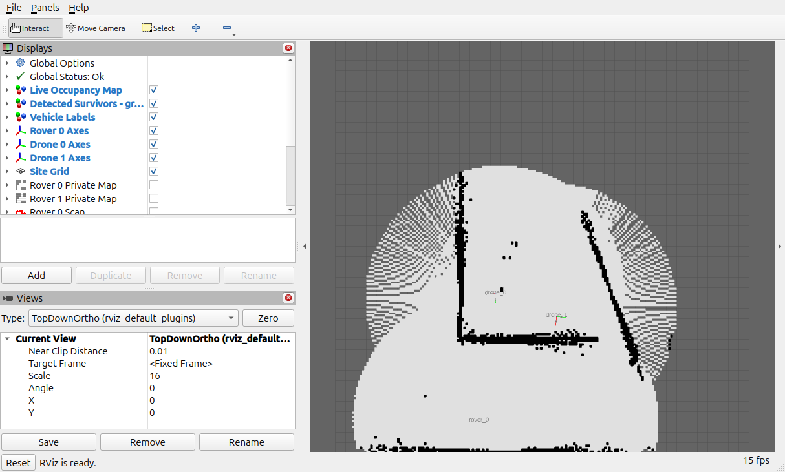](docs/media/simulation-screenshots/02-rviz.png) | [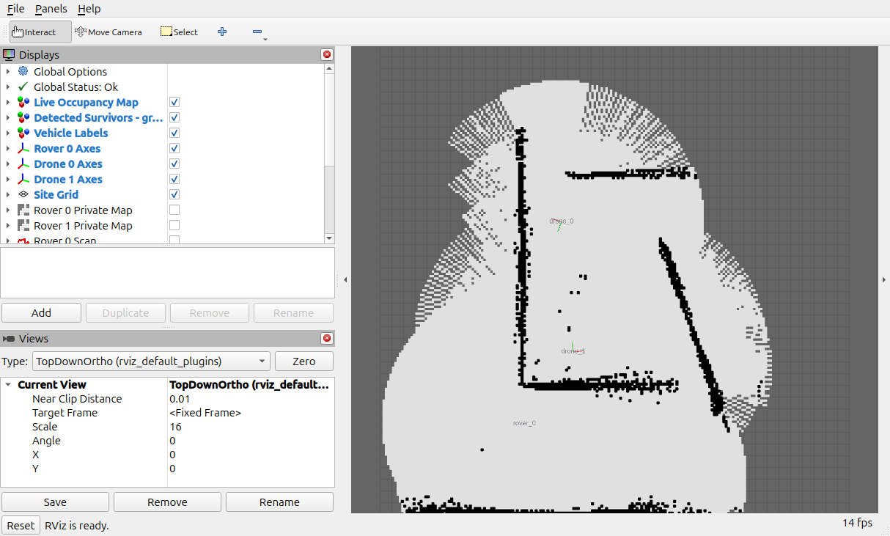](docs/media/simulation-screenshots/10-rviz-progress.png) |

### Rover SLAM and peer telemetry integration

The newer source integration adds separate `slam_toolbox` instances, estimated rover feedback, local scan maps, private occupancy, known-start alignment and radio-delivered map/frontier exchange. Map, odom and base-frame ownership are explicit. Rover SLAM estimates and drone simulator poses remain distinct in the UI.

The runtime probe checks scans, wheel feedback, mapping output, estimated movement, expected frames and applied peer snapshots. **Source/protocol checks and historical RViz screenshots do not prove current loop closure, map accuracy or a reproduced learned ROS controller.** The Linux acceptance guide documents the remaining validation.

| ROS connection interface | Original host records |
| :---: | :--- |
| 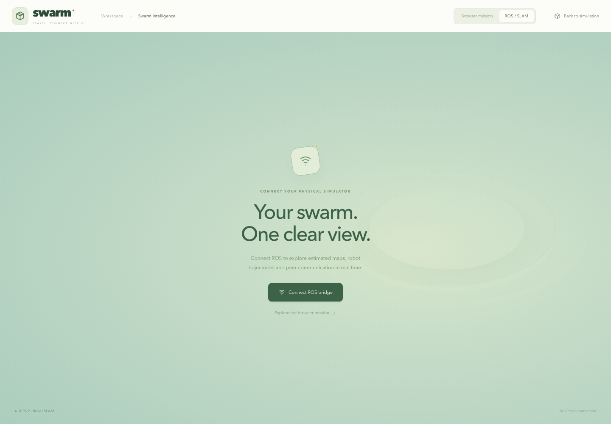 | [Original capture manifest](docs/media/simulation-screenshots/capture-manifest.json) · [ROS launch log](docs/media/simulation-screenshots/run.log) · [Linux SLAM validation prompt](docs/guides/LINUX_SLAM_VALIDATION_PROMPT.md) |

**Policy provenance matters:** the supplied host log reports loaded PPO actors whose hashes differ from the selected grid checkpoint. That host controller implementation is absent from this checkout. The checked-in default physics demo uses waypoint control. The images establish the supplied host session; they do not establish identical policy/runtime integration. [Execution-path explanation](docs/gallery.md#gazebo-and-rviz).

### Run the ROS 2 stack

Use a compatible **Linux ROS/Gazebo installation**. The recorded physics host used ROS 2 Lyrical and Gazebo Sim 10; source your actual installed distribution rather than changing it solely for these examples.

```bash
# From the repository root; replace lyrical if your installed distribution differs.
source /opt/ros/lyrical/setup.bash
rosdep install --from-paths simulation/ros2_ws/src --ignore-src -r -y
cd simulation/ros2_ws
colcon build --symlink-install
source install/setup.bash

# Recorded three-vehicle presentation: one rover, two drones, waypoint control.
ros2 launch swarm_sar_gazebo swarm_sar_sim.launch.py
```

For the **separate two-rover diagnostic SLAM profile**, after stopping the previous world:

```bash
ros2 launch swarm_sar_gazebo slam_demo.launch.py scenario:=rovers controller:=waypoint rosbridge:=true
```

For a headless ROS host, add `headless:=true rviz:=false` to the SLAM launch. To connect a local browser through SSH:

```bash
ssh -N -L 9090:127.0.0.1:9090 USER@ROS_HOST
```

Open the **local** ROS frontend at http://localhost:5173/?mode=ros and connect to `ws://localhost:9090`. A visitor's localhost is their own machine; the public HTTPS app does not automatically reach your host's bridge. Publishing live ROS telemetry securely is a separate integration.

[Physics demo guide](docs/guides/physics_demo.md) · [ROS workspace guide](docs/guides/ros2_gazebo.md) · [SLAM integration and probe commands](docs/guides/slam_integration.md).

## Built to explain as well as demonstrate

| The guided rescue story | A phone-sized learning experience |
| :---: | :---: |
| [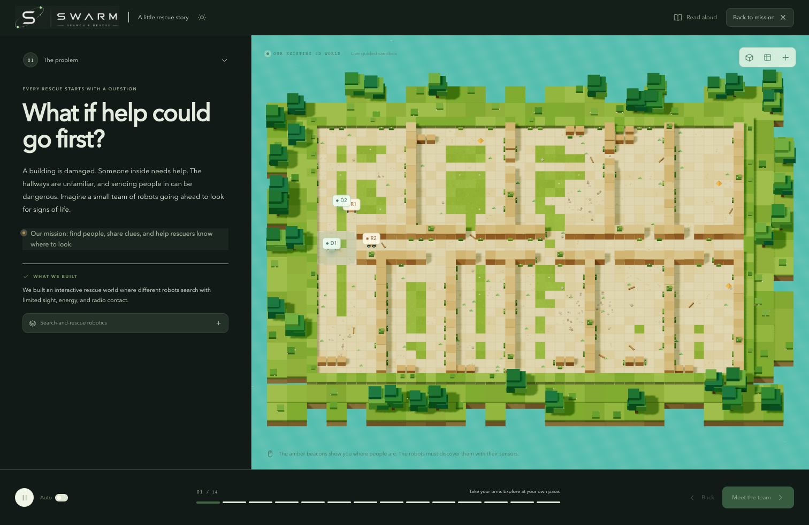](docs/media/readme-2026-11-01/explain-dark.png) | 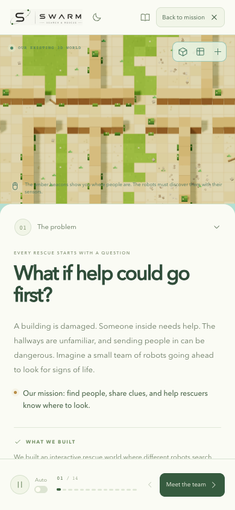 |

The guide starts with a human problem and connects it to sensing, mapping, communication, learning and search. It includes optional browser read-aloud, chapter navigation, small interactive illustrations, source-aware observatory tours and original Gazebo/RViz evidence. It runs an independent seeded sandbox and restores the user's original mission afterward.

### The narrated fieldbook

[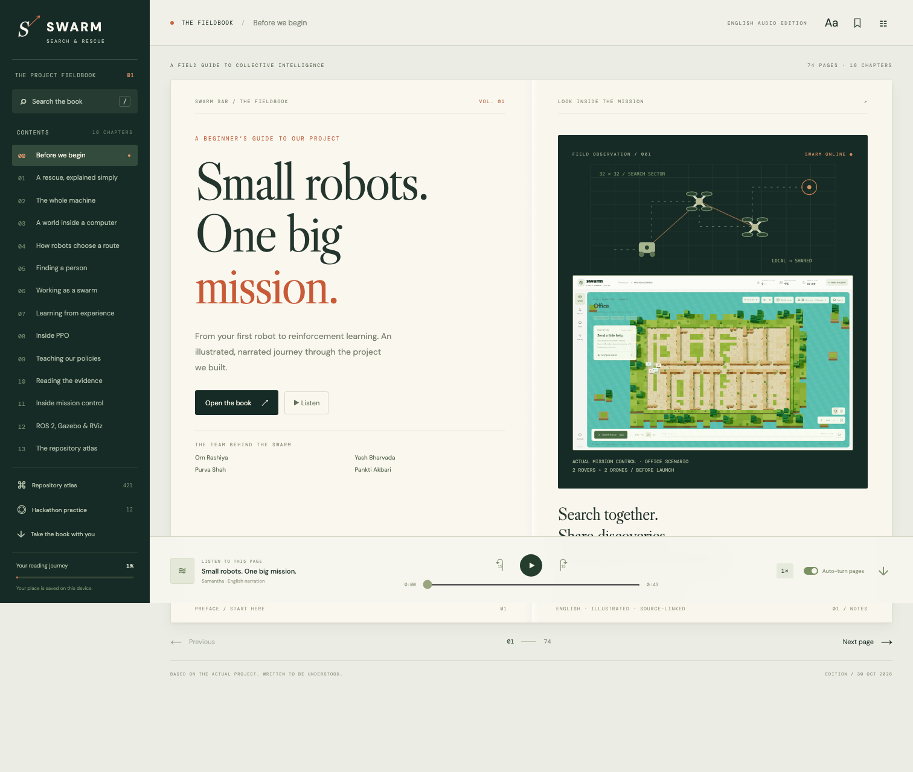](https://swarmsar.vercel.app)

**[Open the English audio fieldbook →](https://swarmsar.vercel.app)**

The published edition contains **91 pages across 20 chapters**, narrated tracks, an approximately **116-minute audiobook**, downloadable materials and a source atlas. It covers the problem, simulator, policies, integration, SLAM and validation. Original images and source references support the explanations; it is not a claim that every experimental path is production ready. [Fieldbook source](guide-site/README.md).

## How the system connects

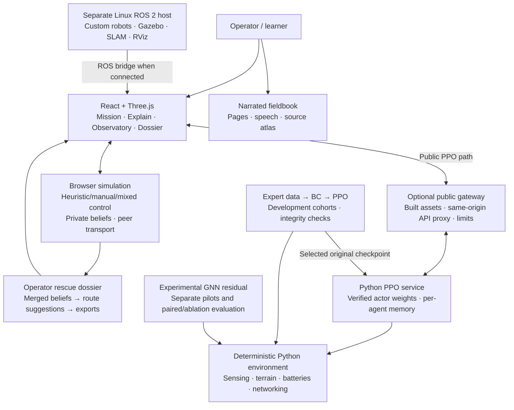

The browser, learned Python grid runtime and physical robotics stack have different state authorities and evidence scopes. The teaching GNN is a UI illustration; the experimental GNN is Python learning code; the selected public policy remains the original recurrent PPO checkpoint.

## Run it yourself

Use **Node.js 18+ and Python 3.12+** for the complete launcher/checkpoint workflow. The simulator package declares Python 3.10+, but the supplied complete workflow uses newer runtime APIs. This repository is public. Clone it into a working folder, then follow the platform-specific setup below.

### Windows · Command Prompt

Install Git, Node.js and Python 3.12, then:

```cmd
git clone --branch main https://github.com/rashiyaom/swarm_os.git
cd swarm_os
py -3.12 -m venv .venv
.venv\Scripts\python.exe -m pip install --upgrade pip setuptools wheel
.venv\Scripts\python.exe -m pip install torch==2.14.1 --index-url https://download.pytorch.org/whl/cpu
.venv\Scripts\python.exe -m pip install -e .
npm.cmd --prefix frontend ci
set OMP_NUM_THREADS=2
set MKL_NUM_THREADS=2
set OPENBLAS_NUM_THREADS=2
npm.cmd run swarm
```

These are **CMD commands**, not PowerShell commands; no `&` prefix or virtual-environment activation is needed. If cloning requires browser authentication, sign in using `gh auth login` and run `gh auth setup-git` first.

### macOS / Linux

```bash
git clone --branch main https://github.com/rashiyaom/swarm_os.git
cd swarm_os
python3 -m venv .venv
.venv/bin/python -m pip install --upgrade pip
.venv/bin/python -m pip install -e .
npm --prefix frontend ci
npm run swarm
```

### Local addresses

| Service | Address |
| :--- | :--- |
| 3D simulator and Explain | http://localhost:5173/ |
| Browser observatory | http://localhost:5173/?mode=observatory |
| ROS telemetry page | http://localhost:5173/?mode=ros |
| PPO health and checkpoint provenance | http://localhost:8765/api/ppo/health |
| Local audio fieldbook | http://localhost:8088/ |

The launcher prepares/verifies the bundled checkpoint, starts or reuses healthy services and reports failures. It does not train a model, install ROS or replace unrelated processes on occupied ports. Keep it running; Ctrl+C stops processes it started. Use `npm run swarm -- --check` for a readiness check.

**Frontend only:** `npm --prefix frontend ci`, then `npm --prefix frontend run dev`. This supports browser heuristic missions and the teaching guide without Python. PPO needs the Python backend. Playback of the included fieldbook is cross-platform; generating new narration uses separate macOS tooling.

### Share your Windows host with the web

Keep the local backend running. In another CMD window:

```cmd
npm.cmd --prefix frontend run build
npm.cmd run public
```

In a third CMD window, after installing Cloudflare's connector:

```cmd
cloudflared tunnel --url http://127.0.0.1:3000
```

Share the HTTPS URL printed by the connector. The public gateway serves the **built app**, checks API request origins and applies body/rate/concurrency limits. The Python service remains on loopback. The backend supports **four active PPO missions** with **30-minute idle expiry**; browser heuristic missions run in each visitor's browser.

The PC, backend, gateway and tunnel must remain running. This is not an automatically restarted production service, and a Quick Tunnel has no uptime guarantee. [Complete Windows hosting guide](docs/guides/windows_public_hosting.md).

### Useful controls

| Action | Control |
| :--- | :--- |
| Launch / pause / resume | `Space`, except while a survivor acknowledgement is required |
| Continue a survivor story | Its **Continue exploration** button |
| Open rescue dossier | Header **Dossier** or `P` |
| Close the dossier | `Escape` or close button |
| Orbit / pan | Mouse drag / right-drag |
| Cursor zoom | Scroll, `+`, `−` |
| Fit / focus | `R` / `F` |
| Hide interface / toggle sound | `H` / `M` |
| Drive a selected manual robot | `W A S D` or arrow keys; manual/mixed mode |
| Sensor scan / stop | `E` / `X` in manual control |
| Change theme | Header light/dark button |
| Inspect robots and missions | Mission / Fleet / Activity panels |

The in-app controls guide is the reference for the selected workspace; text fields and modal dialogs receive their own keyboard input.

## Results with their context

| Recorded evidence | Result | What it establishes |
| :--- | :--- | :--- |
| [Historical browser heuristic audit](docs/validation/browser_swarm_audit.json) | **563/564 survivors**, **199/200 complete missions** | A bounded 50-layout × four-network-condition historical synthetic audit |
| [Historical Python controller audit](docs/audits/step4_validation.md) | **40/42 survivors** across 12 networked missions | A separate decentralized-controller baseline |
| [Selected PPO checkpoint review](models/ppo_754k/ppo_754k_review.json) | **88.80%** combined mean development-cohort recall; paired expert **87.13%** | Development evaluation used for checkpoint selection |
| [Fixed PPO demonstration](docs/validation/ppo_demo_validation.json) | **4/4 survivors**, **94 steps**, **90.48% coverage** | One reproducible development episode using the selected checkpoint |
| [Physics motion evidence](docs/evidence/physics-demo/) | Rover circuits, both drone waypoint stages and requested sensor streams observed | Recorded Linux-host dynamics and integration diagnostics |
| [GNN implementation audit](docs/audits/gnn_implementation_validation.md) | Graph updates, checkpoint integrity, resume and paired/ablation plumbing validated | The experiment executes; an improved policy is not established |

Final-test seeds remain sealed. The policy is weakest on large mazes. Collision shielding is part of the environment: zero post-shield collisions does not establish learned collision avoidance. Changing fleet, energy, duration or map parameters does not automatically inherit benchmark results. [Project report](docs/project_report.md) · [Benchmark protocol](docs/benchmarks/README.md).

## Validation and evidence

The responsive header, compact control placement and theme surfaces were revised after deployment feedback. [Layout/theme audit and current screenshots](docs/audits/frontend_layout_theme.md).

The engineering work includes seeded reproducibility, actual inference, boundary tests, artifact checks and browser/runtime inspection—not only screenshots.

| Current local integration | Validation |
| :--- | :--- |
| **Frontend behavior** | **179 tests passed** across 23 files, including dossier planning/export tests, story sequencing, mission isolation, telemetry, camera, placement and determinism |
| **Production frontend** | TypeScript and Vite build passed |
| **Dossier browser flow** | Three real discoveries acknowledged once each; final story opened the report; JSON/HTML exports and PDF generation worked; mobile layout checked; no JS errors |
| **Public gateway** | Two HTTP integration tests passed; real saved-policy mission create → inference → delete verified through the gateway |
| **Public availability check** | Frontend HTTP 200 and verified CPU PPO health observed externally on 1 November 2026; temporary URL can later go offline |
| **Python / GNN evidence** | See the [recorded implementation audit](docs/audits/gnn_implementation_validation.md) for the validated suite, CPU/GPU boundaries and diagnostic outcomes |
| **ROS / physics evidence** | Original logs, model/controller tests, motion samples and capture records preserved under [physics evidence](docs/evidence/physics-demo/) |

### Where the visuals come from

| Media group | Provenance |
| :--- | :--- |
| Current official-brand workspace, Explain, observatory and GNN stills | [1 November capture manifest with source commit and hashes](docs/media/readme-2026-11-01/capture-manifest.json) |
| Dossier light/dark/mobile captures | [Local integration guide and validation](docs/guides/rescue_dossier.md) |
| Map editor, discovery story, route card and 3D route overlay | [Final showcase capture manifest](docs/media/final-showcase/capture-manifest.json) |
| Historical browser mission GIF and scenario stills | [Browser capture manifest](docs/media/frontend/capture-manifest.json) |
| Python PPO animation | [Inference validation](docs/validation/ppo_demo_validation.json) |
| Gazebo and RViz originals | [Original capture manifest](docs/media/simulation-screenshots/capture-manifest.json) · [Launch log](docs/media/simulation-screenshots/run.log) |
| RViz animation | [Ordered source screenshots and hashes](docs/media/rviz-map-sequence.json) |

Application screenshots are actual captures. Browser worlds and dialogues are simulated; graph attention in the teaching view is illustrative. The Gazebo camera angles represent one supplied session. No visual is offered as evidence of a physical field rescue.

### Run the checks

```bash
npm --prefix frontend test
npm --prefix frontend run build
npm run test:public
python -m pytest -q
python training/scripts/freeze_training_baseline.py --verify
python training/scripts/verify_policy_contract.py
```

Use the repository's Python environment for Python checks; on Windows that is `.venv\Scripts\python.exe`. Historical whole-tree GPU release verification has a known source-manifest mismatch documented in the [GNN audit](docs/audits/gnn_implementation_validation.md); do not interpret it as a newly validated clean release.

## Inside the repository

```text
frontend/                  React/TypeScript interface and deterministic browser engine
  src/scene/               Three.js world, rover/drone models, camera and route overlays
  src/observatory/         Private-map and peer-communication workspace
  src/explain/             Guided story, interactive illustrations and tours
  src/dossier/             Belief merge, route planning, navigation and report export
  src/ppo/                 Authoritative Python snapshot bridge
  src/tests/               Frontend behavior and integration regressions
backend/                   Verified saved-policy CPU mission service
scripts/                   Workspace launcher and bounded public gateway
simulation/
  src/swarm_sar/           Python environments, sensing, mapping, networking and learning
  scripts/                 Viewers, baselines, diagnostics and policy demonstrations
  ros2_ws/                 Robot descriptions, worlds, messages, control and launch files
experiments/gnn/            Graph-attention model, bounded pilots and evaluation
training/                  Configs, expert data, training/evaluation scripts and contracts
models/                    Selected checkpoint bundles and provenance
configs/                   Shared world, robot and network parameters
guide-site/                Published narrated fieldbook and source atlas
docs/                      Guides, architecture, reports, benchmarks, media and evidence
tests/                     Python simulator, backend, learning and ROS-related checks
```

Use **`main` for the integrated project** once approved changes are published. Focused branches carry separate frontend, simulator, training or artifact scopes and can lag behind the latest local integration. [Branch guide](docs/branches.md).

## The development journey

The visible interface rests on several connected engineering stages:

| Stage | Deliverable | Evidence trail |
| :--- | :--- | :--- |
| **Environment foundations** | Seeded worlds, heterogeneous agents, sensing, energy and a PettingZoo-compatible environment | [Python simulation](simulation/src/swarm_sar/) · [Tests](tests/) |
| **Exploration and cooperation** | Frontier baselines, private belief updates, imperfect peer transport and scalability work | [Detailed approach](detailed_approach.md) · [Step 4 audit](docs/audits/step4_validation.md) |
| **Learning pipeline** | Expert data, behavior cloning, PPO contracts, GPU runs, checkpoint selection and saved-policy inference | [Training](training/) · [Model provenance](models/ppo_754k/) |
| **Robotics integration** | Custom robot models, wheel/rotor control, Gazebo worlds, ROS bridging, mapping and recorded Linux probes | [ROS workspace](simulation/ros2_ws/) · [Physics evidence](docs/evidence/physics-demo/) |
| **Mission experience** | 3D controls, authoring, survivor stories, private-map observatory, Python previews and accessible learning tools | [Frontend](frontend/src/) · [Screenshot gallery](docs/gallery.md) |
| **Graph research and operator handoff** | Experimental attention policy, paired ablations, interactive graph explanation and the integrated rescue dossier | [GNN](experiments/gnn/) · [Dossier](frontend/src/dossier/) |
| **Delivery and reproducibility** | One-command startup, bounded public serving, source/checkpoint checks, manifests and narrated documentation | [Launcher](scripts/swarm.mjs) · [Public gateway](scripts/public-server.mjs) · [Fieldbook](guide-site/) |

**Project team:** [Om Rashiya](https://github.com/rashiyaom), [Yash Bharvada](https://github.com/Yash-Bharvada), [Purva Shah](https://github.com/24CS094Purva), and [Pankti Akbari](https://github.com/pankti0409). Commit history, original host records and capture manifests preserve the contributions and provenance behind the project.

## Keep exploring

| Read | Purpose |
| :--- | :--- |
| [Detailed project approach](detailed_approach.md) | Problem, design choices, environment, cooperation, learning and integration |
| [Documentation index](docs/README.md) | Entry point to the documentation tree |
| [Architecture](docs/architecture/architecture.md) | Components and execution paths |
| [Full evidence gallery](docs/gallery.md) | More original captures and their scope |
| [Rescue dossier guide](docs/guides/rescue_dossier.md) | Report behavior, planning assumptions and integration checks |
| [Explain mode](docs/guides/explain_mode.md) | Learning scenes, tours and evidence presentation |
| [PPO frontend integration](docs/guides/ppo_frontend_integration.md) | Preview, checkpoint serving and browser behavior |
| [GNN experiment](experiments/gnn/README.md) | Implemented model, GPU readiness, pilots, evaluation and ablations |
| [Training workspace](training/README.md) | Dataset, source contracts and training operation |
| [Benchmark protocol](docs/benchmarks/README.md) | Development cohorts and evaluation boundaries |
| [ROS / Gazebo guide](docs/guides/ros2_gazebo.md) | Physical workspace setup |
| [Physics demo](docs/guides/physics_demo.md) | One-rover/two-drone presentation and recorded checks |
| [SLAM integration](docs/guides/slam_integration.md) | Frames, private maps, peer exchange and Linux acceptance |
| [Windows public hosting](docs/guides/windows_public_hosting.md) | Built frontend, PPO gateway, tunnel and operational limits |
| [Audio fieldbook](https://swarmsar.vercel.app) | Read, listen and follow the source atlas |

---

<div align="center">

**SWARM · Search & Rescue**

From local observations to shared discoveries—and from a working simulation to evidence people can inspect.

[**Read & listen: SWARM SAR field guide ↗**](https://swarmsar.vercel.app)

</div>
