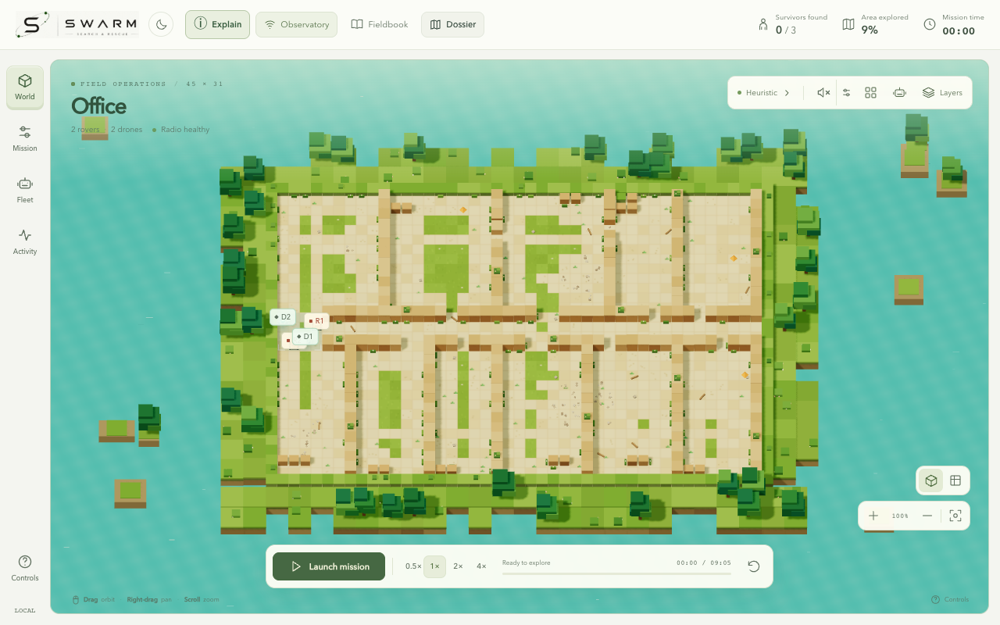
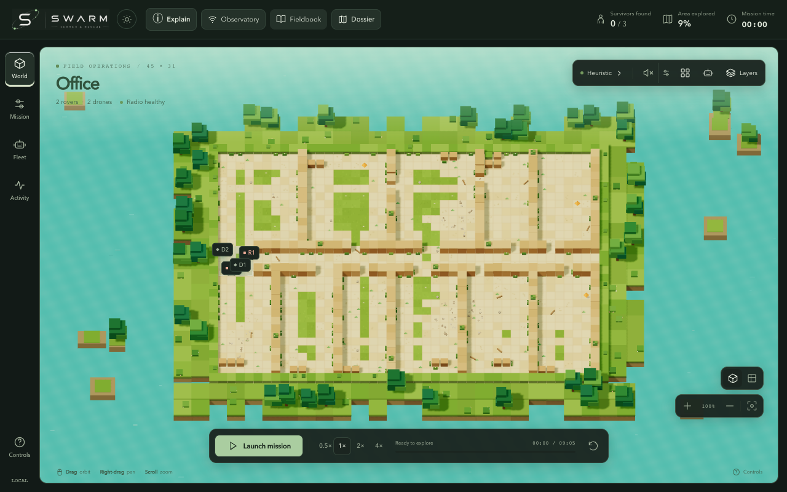

# Frontend layout and theme correction

1 November 2026. The fixed-width header exceeded its available width after the
new branding and dossier buttons were added. Theme overrides also covered only
some surfaces, leaving light-only backgrounds and dark text in multiple panels.

## Changes

- Grouped brand/theme controls and mission actions, reduced header/rail/control
  density, and adapted secondary metrics to available width. Essential actions
  retain accessible labels when their visible text becomes compact.
- Compact playback and camera controls; overlay drawers on narrower screens;
  scrollable story/mission-report content at short viewport heights.
- Native `light-dark()` values throughout the eight component stylesheets, backed
  by shared foreground, surface, border, accent and severity tokens. Current
  Chrome/Edge and other modern browsers supporting `light-dark()` are required.
- Readable muted labels in light mode, coherent dark controls and popovers, and
  corrected primary button, dossier legend and ROS-label contrast.
- Authored world/evidence colors and semantic status indicators preserved;
  transparent world overlays remain transparent. Print output uses a light palette.

## Validation

- **179 frontend tests passed** and TypeScript/Vite production build passed.
- Header/actions contained at **eight widths: 320–1920 px**.
- No sampled dark-theme contrast failures in 15 groups: Mission, Fleet, Activity,
  Help, Layers, Explain, story navigation, selected robot, Audio, map editor,
  survivor story, dossier, selected-survivor report, GNN and ROS connection.
- Browser flow exercised actual survivor discoveries and report opening; no
  JavaScript errors. Theme persistence and light print scheme checked separately.
- The contrast check measures HTML foreground/background values with a small
  numerical tolerance around 4.5:1. It excludes disabled controls and SVG/WebGL;
  it is not a complete accessibility certification or live ROS validation.

[Structured results and screenshot hashes](../validation/frontend_layout_theme.json).

| Light | Dark |
| :---: | :---: |
|  |  |

[Mobile layout](../media/interface-polish/mobile-light.png).

To reproduce with a running frontend and Playwright/Chrome installed:

```bash
python frontend/tools/validate_layout_theme.py --url http://localhost:5173
```

Use `--browser-executable /absolute/path/to/chrome` if Chrome is not discoverable,
and `--output /path/to/results` to choose the evidence directory.
